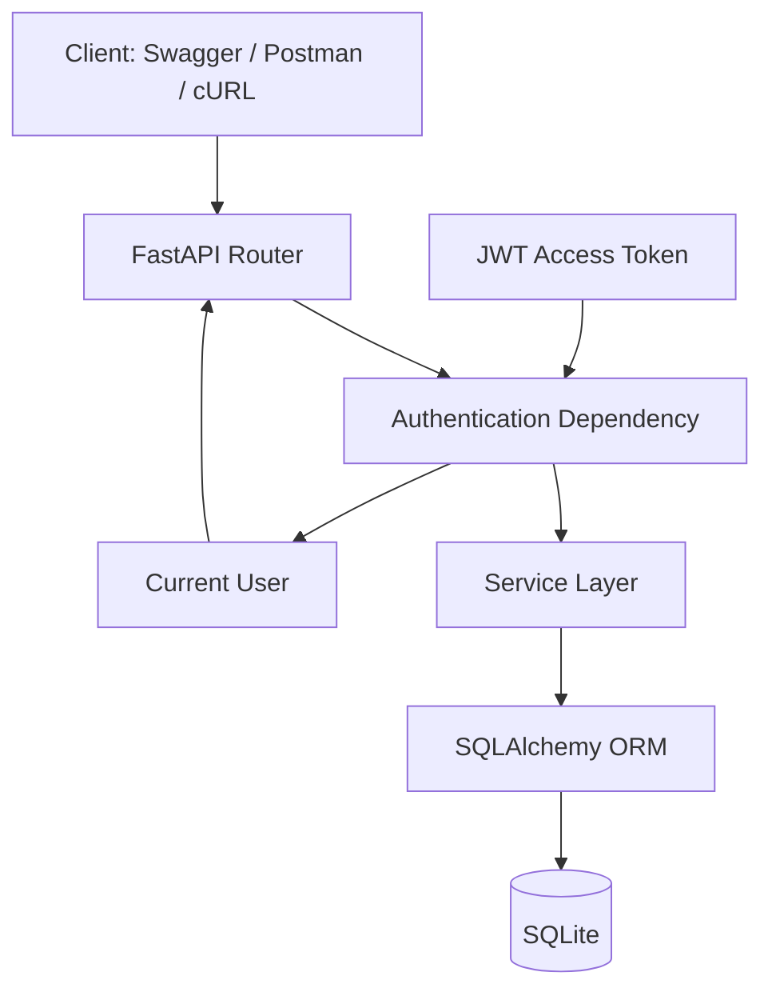
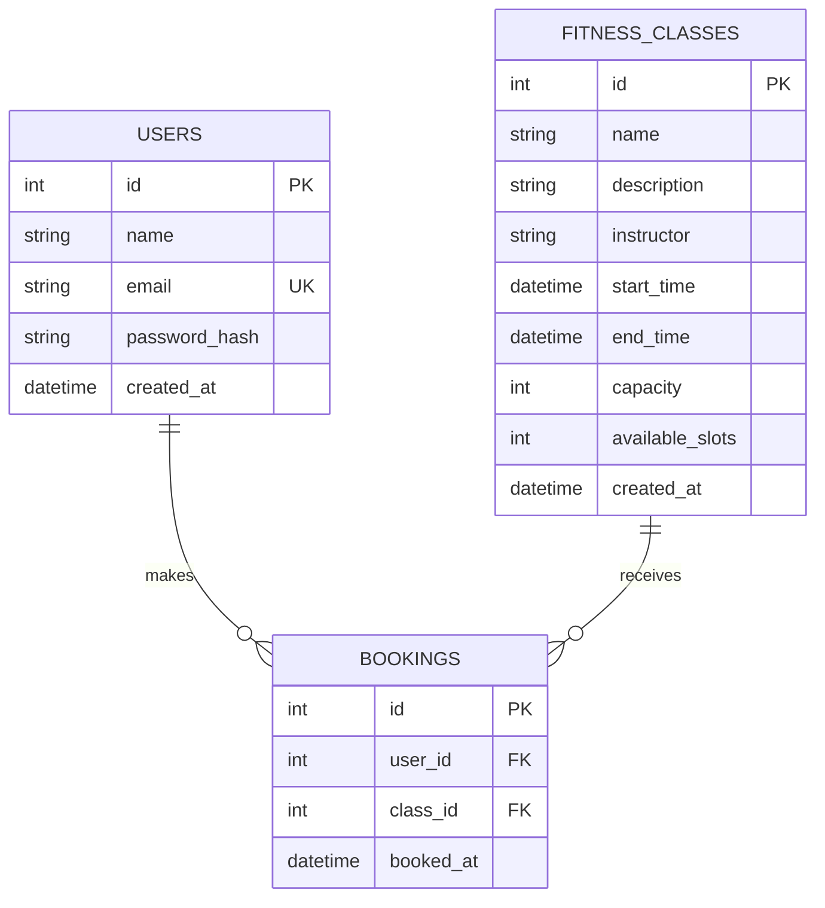

# Fitness Studio Booking API

A secure RESTful backend built with FastAPI, SQLAlchemy 2.x, SQLite, Pydantic v2 and JWT authentication for managing fitness classes and user bookings.

## Problem Statement

Users can register, authenticate, browse upcoming fitness classes, create classes, book available classes and view only their own bookings. The API protects against duplicate registrations, invalid authentication, duplicate bookings, booking started/past classes, full classes and overbooking.

## Features

- JWT access and refresh tokens
- Short-lived access tokens and configurable refresh tokens
- Scrypt password hashing
- Protected class creation and booking endpoints
- Public upcoming-class listing
- User-scoped booking history
- Database-level unique booking constraint
- Conditional slot decrement for overbooking protection
- IST (`Asia/Kolkata`) timezone handling
- Pydantic request/response validation
- Structured HTTP errors
- Python logging without secrets/tokens/passwords
- Swagger/OpenAPI and ReDoc
- Pytest test suite
- Seed data for local demonstration
- Health check endpoint

## Tech Stack

- Python 3.11+
- FastAPI
- SQLAlchemy 2.x
- SQLite
- Pydantic v2 / pydantic-settings
- PyJWT
- Cryptography Scrypt
- Pytest + HTTPX
- Uvicorn
- python-dotenv
- `zoneinfo`

## Architecture



## Project Structure

```text
fitness-studio-booking-api/
├── app/
│   ├── main.py
│   ├── core/
│   │   ├── config.py
│   │   ├── database.py
│   │   ├── logging_config.py
│   │   └── security.py
│   ├── models/
│   │   ├── __init__.py
│   │   ├── user.py
│   │   ├── fitness_class.py
│   │   └── booking.py
│   ├── schemas/
│   │   ├── __init__.py
│   │   ├── user.py
│   │   ├── auth.py
│   │   ├── fitness_class.py
│   │   └── booking.py
│   ├── routers/
│   │   ├── __init__.py
│   │   ├── auth.py
│   │   ├── classes.py
│   │   └── bookings.py
│   ├── services/
│   │   ├── __init__.py
│   │   ├── auth_service.py
│   │   ├── class_service.py
│   │   └── booking_service.py
│   ├── dependencies/
│   │   ├── __init__.py
│   │   └── auth.py
│   └── utils/
│       ├── __init__.py
│       └── timezone.py
├── tests/
│   ├── __init__.py
│   ├── conftest.py
│   ├── test_auth.py
│   ├── test_classes.py
│   └── test_bookings.py
├── seed.py
├── requirements.txt
├── .env.example
├── .gitignore
└── README.md
```

## Database Design

### Users

- `id` primary key
- `name`
- `email` unique + indexed
- `password_hash`
- `created_at`

### Fitness Classes

- `id`
- `name`
- `description`
- `instructor`
- `start_time`
- `end_time`
- `capacity`
- `available_slots`
- `created_at`

### Bookings

- `id`
- `user_id` foreign key
- `class_id` foreign key
- `booked_at`
- unique constraint on `(user_id, class_id)`



## Authentication Flow

1. `POST /signup` validates user data and stores a Scrypt password hash.
2. `POST /login` verifies the password and issues access + refresh JWTs.
3. Protected requests send `Authorization: Bearer <access-token>`.
4. `get_current_user()` validates signature, expiration, token type and user ID.
5. `POST /refresh` accepts only a refresh token and issues a new access token.

JWT claims include `sub`, `iat`, `exp` and `type`. Refresh tokens are explicitly rejected by protected endpoints.

## API Endpoints

| Method | Path | Auth | Purpose |
|---|---|---|---|
| POST | `/signup` | Public | Register user |
| POST | `/login` | Public | Login and receive tokens |
| POST | `/refresh` | Public | Issue new access token |
| GET | `/classes` | Public | List upcoming classes |
| POST | `/classes` | Bearer | Create class |
| POST | `/book` | Bearer | Book class |
| GET | `/bookings` | Bearer | Current user's bookings |
| GET | `/health` | Public | Health check |
| GET | `/docs` | Public | Swagger UI |
| GET | `/redoc` | Public | ReDoc |

## Timezone Handling

The canonical application timezone is `Asia/Kolkata` (IST, UTC+05:30).

- Class input datetimes must include a timezone offset.
- Input is normalized to IST.
- SQLite stores the normalized ISO-8601 value including the `+05:30` offset.
- Python comparisons use timezone-aware datetimes.
- API responses return timezone-aware timestamps.
- The application does not manually add or subtract hours.

## Booking Logic and Overbooking Protection

The booking operation follows this order:

1. Authenticate user.
2. Find class.
3. Reject nonexistent class.
4. Reject class that has already started.
5. Check duplicate booking.
6. Atomically decrement `available_slots` only when it is greater than zero.
7. Create booking.
8. Commit the transaction.
9. Roll back if booking creation fails.

The database also enforces `UNIQUE(user_id, class_id)` and check constraints on capacity/slots. The conditional update prevents two successful writers from decrementing an exhausted slot.

For SQLite, the design deliberately uses a short transaction and an atomic conditional update rather than a database-specific row-locking API.

## Error Handling

- `200` successful read/login/refresh
- `201` created
- `401` missing/invalid authentication
- `404` resource not found
- `409` duplicate/conflict/full class
- `422` validation error
- `500` unexpected server error

Passwords, password hashes, JWTs, secrets and stack traces are not returned or logged.

## Environment Variables

Copy `.env.example` to `.env` and set a strong secret:

```env
DATABASE_URL=sqlite:///./fitness.db
SECRET_KEY=replace-with-a-long-random-secret-at-least-32-characters
ALGORITHM=HS256
ACCESS_TOKEN_EXPIRE_MINUTES=30
REFRESH_TOKEN_EXPIRE_DAYS=7
```

Never commit `.env`.

## Installation

### 1. Create virtual environment

Windows PowerShell:

```powershell
python -m venv .venv
.venv\Scripts\Activate.ps1
```

Windows CMD:

```cmd
.venv\Scripts\activate
```

macOS/Linux:

```bash
python3 -m venv .venv
source .venv/bin/activate
```

### 2. Install dependencies

```bash
pip install -r requirements.txt
```

### 3. Configure environment

```bash
copy .env.example .env
```

On macOS/Linux:

```bash
cp .env.example .env
```

Edit `.env` and set a strong `SECRET_KEY`.

## Seed Data

Run:

```bash
python seed.py
```

This creates future Yoga, Zumba and HIIT classes and a demo user.

Demo login:

```text
Email: demo@example.com
Password: DemoPassword123
```

The seed script hashes the demo password; it never stores the plaintext password in the database.

## Run the Application

```bash
uvicorn app.main:app --reload
```

Open:

- Swagger: http://127.0.0.1:8000/docs
- ReDoc: http://127.0.0.1:8000/redoc
- Health: http://127.0.0.1:8000/health

## Swagger Testing Flow

1. Open `/docs`.
2. Run `/signup`.
3. Run `/login`.
4. Copy the `access_token`.
5. Click **Authorize**.
6. Enter the token using the Bearer scheme.
7. Create a class.
8. List classes.
9. Book a class.
10. Get bookings.
11. Try duplicate booking.
12. Try a full class.
13. Test refresh token.

## cURL Examples

### Signup

```bash
curl -X POST http://127.0.0.1:8000/signup \
  -H "Content-Type: application/json" \
  -d '{"name":"Jaswanth","email":"jaswanth@example.com","password":"StrongPassword123"}'
```

### Login

```bash
curl -X POST http://127.0.0.1:8000/login \
  -H "Content-Type: application/json" \
  -d '{"email":"jaswanth@example.com","password":"StrongPassword123"}'
```

### Get Classes

```bash
curl http://127.0.0.1:8000/classes
```

### Create Class

```bash
curl -X POST http://127.0.0.1:8000/classes \
  -H "Content-Type: application/json" \
  -H "Authorization: Bearer ACCESS_TOKEN" \
  -d '{"name":"Yoga","description":"Morning yoga session","instructor":"Priya","start_time":"2026-10-20T07:00:00+05:30","end_time":"2026-10-20T08:00:00+05:30","capacity":20}'
```

### Book

```bash
curl -X POST http://127.0.0.1:8000/book \
  -H "Content-Type: application/json" \
  -H "Authorization: Bearer ACCESS_TOKEN" \
  -d '{"class_id":1}'
```

### My Bookings

```bash
curl http://127.0.0.1:8000/bookings \
  -H "Authorization: Bearer ACCESS_TOKEN"
```

### Refresh

```bash
curl -X POST http://127.0.0.1:8000/refresh \
  -H "Content-Type: application/json" \
  -d '{"refresh_token":"REFRESH_TOKEN"}'
```

## Testing

Run the complete suite:

```bash
pytest -q
```

The tests cover signup, duplicate signup, login, invalid credentials, refresh tokens, protected endpoints, class validation, upcoming classes, booking success, duplicate booking, full-class rejection, slot integrity and user-scoped bookings.

Tests use a separate SQLite database and do not use the production `fitness.db`.

## Manual End-to-End Verification

1. Start the server.
2. Open Swagger.
3. Sign up.
4. Verify the user in SQLite.
5. Login.
6. Authorize with the access token.
7. Create Yoga.
8. GET classes.
9. Book Yoga.
10. Verify `available_slots` decreased.
11. GET bookings.
12. Repeat the same booking and verify `409`.
13. Create a class with capacity `1`.
14. Book it as User A.
15. Attempt booking as User B and verify `409`.
16. Refresh the access token.
17. Use a refresh token against a protected endpoint and verify `401`.
18. Run `pytest -q`.

## Security Checklist

- [x] Passwords hashed with Scrypt
- [x] JWT secret loaded from environment
- [x] `.env` ignored
- [x] Passwords/hashes excluded from responses
- [x] Passwords/JWTs/secrets excluded from logs
- [x] Protected routes require bearer access token
- [x] Access and refresh token types are separated
- [x] Token expiration enforced
- [x] Duplicate booking prevented in service and database
- [x] Overbooking prevented with conditional update + transaction
- [x] Pydantic input validation
- [x] SQLAlchemy parameterization/ORM usage
- [x] User booking scope derived from JWT, not query parameters

## Design Decisions

### Why routers and services?

Routers focus on HTTP concerns. Services contain business rules, making the booking and authentication logic easier to test and maintain.

### Why a unique booking constraint?

Service-level checks improve user-facing errors, while the database constraint provides defense in depth under concurrent requests.

### Why conditional slot decrement?

A simple read-then-decrement sequence can suffer from a race condition. The conditional SQL update makes the decrement succeed only when a slot is still available.

### Why SQLite?

SQLite is explicitly required for the assignment and is sufficient for a focused evaluation project. The transaction is intentionally short and the concurrency strategy is documented.

### Why no admin role?

The assignment does not require role-based administration. Adding RBAC would increase complexity without satisfying an explicit requirement.

## Assumptions

- All class times use IST as the canonical timezone.
- A class cannot be created if its start time is already in the past.
- Booking is allowed until the class start time.
- A user may book a class only once.
- Refresh tokens are stateless JWTs; token revocation/rotation is outside the assignment scope.
- SQLite is the target database for this assignment.

## Future Improvements

If production scale were required, the service could move to PostgreSQL, add refresh-token rotation/revocation, database migrations, rate limiting, structured JSON logs, observability and a dedicated distributed locking/transaction strategy. Those are intentionally outside this assignment's scope.

## Author

Jaswanth N
